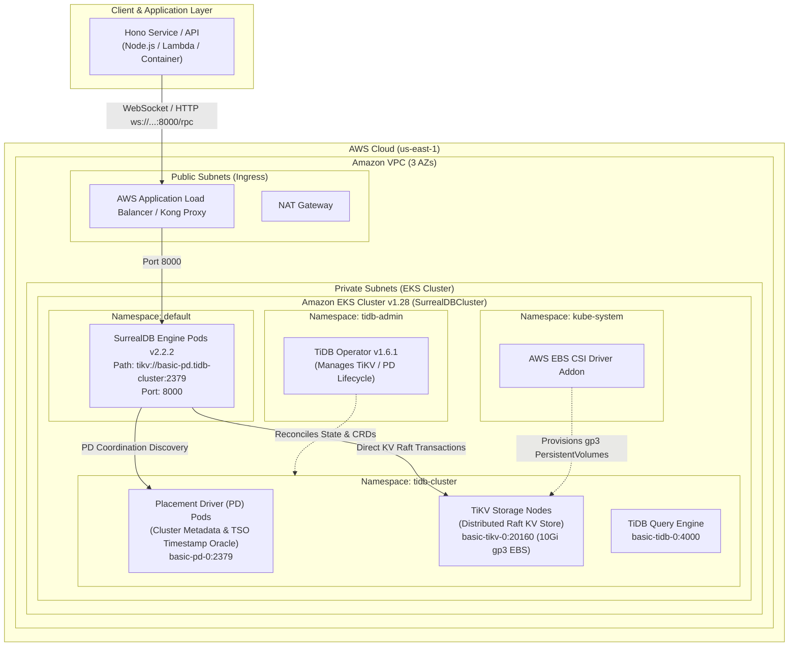

# Architecture Overview: SurrealDB on TiKV via AWS EKS

This document details the production architecture for deploying **SurrealDB** backed by a distributed, scalable **TiKV** cluster on **Amazon EKS** using **SST** (Serverless Stack) and **Pulumi**.



---

## Component Roles & Storage Routing

### 1. Network Topology (Amazon VPC)
- **Multi-AZ Distribution**: Spans 3 Availability Zones (`us-east-1a`, `us-east-1b`, `us-east-1c`) for fault tolerance.
- **Subnet Separation**:
  - `Public Subnet`: Hosts internet-facing Application Load Balancers and NAT Gateways.
  - `Private Subnet`: Encapsulates all EKS worker nodes, TiKV stateful pods, and SurrealDB pods with no direct public IPs.

### 2. TiDB Operator & TiKV Engine
- **TiDB Operator** (`v1.6.1`): Deployed in `tidb-admin`, manages custom resources (`TidbCluster`, `TidbMonitor`).
- **Placement Driver (PD)**: Coordinates timestamp ordering (TSO), data placement, and region balancing across TiKV nodes. Listens on `basic-pd.tidb-cluster.svc.cluster.local:2379`.
- **TiKV Nodes**: Rust-based distributed transactional key-value store using Raft consensus. Data is mounted on AWS EBS `gp3` volumes backed by the `aws-ebs-csi-driver`.

### 3. SurrealDB Storage Engine Integration
- **Engine Path**: SurrealDB connects natively to TiKV using the TiKV client driver via the PD connection string:
  ```
  tikv://basic-pd.tidb-cluster.svc.cluster.local:2379
  ```
- **Transaction Model**: SurrealDB leverages TiKV's multi-version concurrency control (MVCC) and ACID two-phase commit transactions for graph, document, and relational queries.

### 4. Hono Client Application Layer
- **Interface**: Connects to SurrealDB over WebSocket/HTTP RPC on port `8000`.
- **Authentication**: Authenticates using root or scoped credentials with namespace (`test`) and database (`test`).
